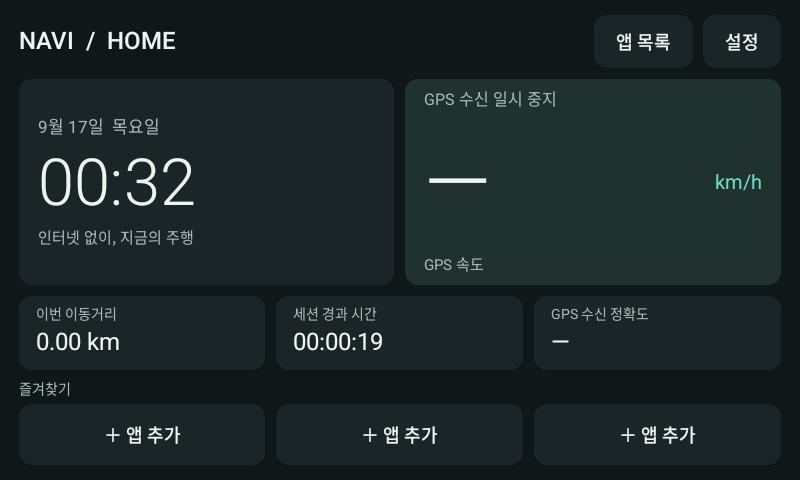

# Navi 홈

오래된 파인드라이브 내비게이션에서 사용하는 Android 차량용 홈과 휴대폰 화면 송신 앱입니다. 현재 홈 버전은 **0.6**, 송신 앱은 **0.1**입니다. Android 프레임워크와 Java로 구현했으며 외부 앱 라이브러리나 Google Play Services에 의존하지 않습니다.



## 현재 기능

- 큰 시계와 날짜, GPS 속도·수신 상태·정확도
- 현재 세션 이동거리와 경과 시간
- 앱 즐겨찾기 3개, 설치된 실행 가능 앱 목록
- 홈 밝기·미디어 음량, 부팅 자동 실행 설정
- 제조사 홈·설정 복귀, 저장공간·센서·USB 진단
- Wi-Fi 설정·재연결 시험, 휴대폰 미러링 및 Android Auto 연결 시험

GPS 미수신, 오래된 수신값, 속도 값이 없는 경우 속도는 `—`로 표시합니다. 좌표·이동 경로·세션 집계는 파일에 저장하지 않습니다. 세션 집계는 프로세스 종료나 재부팅 때 초기화됩니다. 정차 흔들림을 줄이기 위해 약 5.4km/h 미만의 저속 구간은 거리에 덜 반영될 수 있습니다.

제조사 카메라 화면이 나타나면 Activity가 화면을 넘겨주고, 미러링 렌더링을 중단합니다. GPS 서비스는 살아 있는 동안 집계를 이어갑니다. 카메라 위로 강제로 홈을 띄우지 않습니다.

## 기기와 검증 범위

사용자가 알려준 기기는 **2016년 제조 Finedrive iQ 3**, 화면은 **800×480**입니다. 본체 라벨로 세부 모델을 최종 확인한 상태는 아닙니다.

| 앱 | 패키지 | 최소 Android | Target SDK |
|---|---|---|---|
| 내비 홈·수신 앱 | `local.navi.diagnostic` | 5.0 / API 21 | 28 |
| 휴대폰 송신 앱 | `local.navi.sender` | 10 / API 29 | 35 |

사용자 실물 확인 범위는 초기 APK 설치·실행, 0.2 부팅 자동 실행, R 후방/D 전방 카메라 전환, GPS 수신입니다. 0.6 APK는 2026-09-17 SD카드 복사·검증을 완료했으나 이후 본체 설치 결과는 아직 보고받지 못했습니다.

GPS 계산 검사 24개와 0.6 에뮬레이터 검사 27개를 수행했습니다. 에뮬레이터 결과는 실제 Android 5 기기의 성능·카메라 공존·정확한 주행 거리 검증을 대신하지 않습니다. Wi-Fi 동글 호환성, 실제 휴대폰 영상·Android Auto 투영은 미확인입니다. OBD는 아직 구현하지 않았습니다.

- [0.6 구현·검증 범위](reports/offline-validation.md)
- [오프라인 사용법과 정차 시험](staging/OFFLINE-HOME-KO.txt)
- [연결 시험 순서](staging/EVENING-TEST-KO.txt)
- [미러링 프로토콜과 수명주기](reports/mirroring-design.md)
- [Wi-Fi 조사](reports/iq3-wifi-offline-20260917.md)

## 소스 구조

| 경로 | 내용 |
|---|---|
| `diagnostic/` | 내비 홈, GPS 서비스, 앱 실행, Wi-Fi·연결 진단, H.264 수신 |
| `sender/` | 휴대폰 화면 공유 승인, MediaProjection 캡처, H.264 송신 |
| `shared/` | 로컬 영상 전송 프로토콜, 인증·암호화, 프레임 큐 |
| `tests/java/` | GPS 집계, 프레임·프로토콜, Wi-Fi 재연결, 주소 검증 |
| `tools/` | 빌드·검사·패키징·로컬 배포 도구 |
| `staging/` | 설치·실물 시험 안내, 앱 목록 표시용 빈 파일 |
| `reports/` | 선별한 설계·검증 문서와 앱 화면 |

SD카드 백업, 제조사 APK·펌웨어, 개인 서명키, 생성된 APK·ZIP과 개별 기기 배포 기록은 Git에 포함하지 않습니다. 일부 보고서에서 참조하는 원시 로그·JSON은 로컬 검증 기록입니다. `ring-case/`는 별도 작업으로 이 저장소 범위에서 제외합니다.

## 빌드

필요한 도구는 Python 3, JDK 21, Android SDK Platform 36, Build Tools 35.0.0입니다. Python 외부 패키지는 필요하지 않습니다. SDK와 JDK는 별도로 설치합니다.

```bash
export ANDROID_SDK_ROOT="/path/to/Android/sdk"
export JAVA_HOME="/path/to/jdk-21"
```

macOS의 `~/Library/Android/sdk`, Linux의 `~/Android/Sdk`, Apple Silicon Homebrew의 JDK 21 경로는 자동 탐색합니다. SDK 버전을 바꾸려면 `NAVI_BUILD_TOOLS_VERSION`, `NAVI_COMPILE_API`를 지정할 수 있지만 현재 검증 기준은 위 버전입니다.

서명키는 별도 보관합니다. 기존 설치를 업데이트하려면 **같은 패키지와 원래 서명키**가 필요합니다. 빌드 도구는 키를 자동 생성하거나 다른 키로 대체하지 않습니다.

```bash
export NAVI_KEYSTORE="/path/to/original-signing-key.p12"
# 비밀번호는 화면에 표시하지 않고 현재 셸 환경에만 설정합니다.
read -r -s NAVI_KEYSTORE_PASSWORD
export NAVI_KEYSTORE_PASSWORD
# 키 비밀번호가 다르면 NAVI_KEY_PASSWORD도 별도로 설정합니다.
python3 tools/build_diagnostic.py --app all
unset NAVI_KEYSTORE_PASSWORD NAVI_KEY_PASSWORD
```

로컬 원래 키의 기본 경로는 `diagnostic/keys/local-development.p12`입니다. 키를 보유하지 않은 새 개발 환경에서는 본인이 관리하는 별도 시험 키를 명시적으로 준비해야 하며, 해당 키로 만든 APK는 원래 기기에 설치된 앱을 업데이트할 수 없습니다.

산출물은 `staging/NaviDiagnostic-0.6.apk`, `staging/NaviSender-0.1.apk`와 각 SHA-256 파일입니다. Android 5용 v1 서명을 포함해 검증합니다. APK와 ZIP은 Git에서 제외됩니다.

## 검사와 패키징

다음 계산·프로토콜 검사는 Android SDK나 기기, 서명키 없이 Python 3와 JDK로 실행할 수 있습니다.

```bash
python3 tools/test_trip.py
python3 tools/test_stream.py
python3 tools/test_wifi.py
python3 tools/test_phone_address.py
```

두 앱을 빌드한 뒤 API 호출 목록과 SD카드용 오프라인 묶음을 만들 수 있습니다.

```bash
python3 tools/check_android_api.py
python3 tools/package_offline_home.py
```

API 검사는 최신 API 호출 목록을 만들며 버전 분기의 정확성을 자동 증명하지 않습니다. `emulator_*` 스크립트는 개발 당시의 별도 임시 AVD와 이전 APK들을 사용하는 회귀 시험 기록입니다. 현재 소스만으로 과거 APK가 모두 재생성되지는 않습니다. 개인 기기를 대상으로 실행하지 말고 별도 시험 환경에서 사용합니다. SD 배포 도구는 원래 카드의 검증된 로컬 백업과 파일 식별이 있어야 동작합니다.

## 휴대폰 연결 시험

송신 앱은 사용자의 화면 공유 승인을 받은 후 H.264 영상을 로컬 TCP로 전송합니다. 수신은 MediaCodec으로 재생합니다. 초기 설정은 최대 800×480, 15fps, 2Mbps이며 영상 표시만 제공합니다. 터치 역전송이나 음성 전송은 구현하지 않았습니다. 화면 잠금·공유 종료 뒤에는 새 승인이 필요합니다.

두 기기를 같은 로컬 네트워크에 연결합니다. 휴대폰 핫스팟에 내비를 연결하는 구성도 가능합니다. iQ 3 공식 설명서는 ‘리얼타임3D 전용 WiFi 동글’을 별매품으로 안내하지만 개별 판매품의 호환성은 별도 확인해야 합니다.

Android Auto 시험에서는 별도 앱인 [Open Headunit](https://github.com/andreknieriem/open-headunit/releases/tag/v.3.3.0)의 공개 실행·연결 인터페이스를 호출합니다. 해당 앱의 코드나 APK는 이 저장소에 포함하지 않습니다. 출처·라이선스 안내는 [OPENHEADUNIT-NOTICES.txt](staging/OPENHEADUNIT-NOTICES.txt)에 있습니다.
